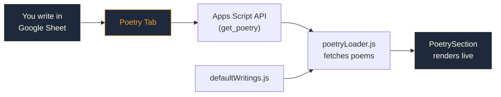

# Poetry CMS — Google Sheets Backend

## How It Works

Your poetry is now managed through a **"Poetry" tab** in your Google Sheet. The website automatically fetches poems from this sheet on every page load.

### Architecture Flow

## Setup Steps

### 1. Update Apps Script in Google Sheets

> [!IMPORTANT]
> You must redeploy the Apps Script for the Poetry tab to work.

1. Open your Google Sheet → **Extensions > Apps Script**
2. Replace **all code** in `Code.gs` with the contents of [`scripts/google-apps-script.js`](file:///Users/hiijitesh/Documents/hiijitesh.github.io/scripts/google-apps-script.js)
3. **Deploy** → Manage deployments → Edit → New version → Deploy

### 2. The "Poetry" Sheet Tab (Auto-Created)

On the first `get_poetry` API call, the script **auto-creates** a `Poetry` tab with these columns:

| Column | Header | What to Write |
|--------|--------|---------------|
| A | `id` | Unique slug, e.g. `mere-soch-pare-bhi` (no spaces, lowercase) |
| B | `category` | `Poetry`, `Nazm`, or `Shayari` |
| C | `title` | Hinglish title, e.g. `Mere Soch Pare Bhi` |
| D | `title_hi` | Hindi title, e.g. `मेरे सोच परे भी` |
| E | `date` | Display date, e.g. `Oct 2026` |
| F | `excerpt` | 1–2 line preview in Hinglish |
| G | `content` | Full poem body — Hinglish. Use **Alt+Enter** for newlines |
| H | `content_hi` | Full poem body — Hindi Devanagari |
| I | `status` | **Published** or **Draft** |

### 3. Writing a New Poem

1. Open the `Poetry` tab in your Google Sheet
2. Fill a new row with all columns
3. Set status to **Draft** while writing
4. When ready → change status to **Published**
5. Refresh your website — the poem appears instantly! 🎉

> [!TIP]
> For multi-line poems in a single cell, press **Alt+Enter** (Windows) or **Ctrl+Enter** (Mac) to add a line break inside the cell.

### 4. How the Fallback Works

- [`defaultWritings.js`](file:///Users/hiijitesh/Documents/hiijitesh.github.io/js/data/defaultWritings.js) has your 4 original poems hardcoded
- [`poetryLoader.js`](file:///Users/hiijitesh/Documents/hiijitesh.github.io/js/utils/poetryLoader.js) fetches from Google Sheets, then **merges**:
  - Sheet poems **override** defaults (matched by `id`)
  - Any defaults not in the sheet are **appended** (safety net)
- If the user is offline or on `file://` protocol → defaults render instantly

## Files Changed

| File | What Changed |
|------|-------------|
| [`scripts/google-apps-script.js`](file:///Users/hiijitesh/Documents/hiijitesh.github.io/scripts/google-apps-script.js) | Added `get_poetry` action + auto-creates Poetry tab |
| [`js/utils/poetryLoader.js`](file:///Users/hiijitesh/Documents/hiijitesh.github.io/js/utils/poetryLoader.js) | **New** — fetches poems from sheet, merges with defaults |
| [`js/components/PoetrySection.js`](file:///Users/hiijitesh/Documents/hiijitesh.github.io/js/components/PoetrySection.js) | Uses PoetryLoader instead of local JSON fetch |
| [`index.html`](file:///Users/hiijitesh/Documents/hiijitesh.github.io/index.html) | Added `poetryLoader.js` script tag |

> [!NOTE]
> Your existing `defaultWritings.js` is **kept as-is** for offline fallback. You can eventually remove poems from it once they're all in the Google Sheet — the sheet becomes your single source of truth.
