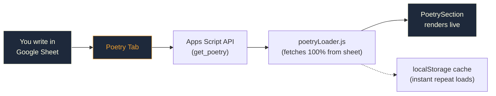

# Poetry CMS — Google Sheets Backend

## How It Works

Your poetry is now managed through a **"Poetry" tab** in your Google Sheet. The website automatically fetches poems from this sheet on every page load.

### Architecture Flow

## Setup Steps

### 1. Update Apps Script in Google Sheets

> [!IMPORTANT]
> You must redeploy the Apps Script for the Poetry tab to work.

1. Open your Google Sheet → **Extensions > Apps Script**
2. Replace **all code** in `Code.gs` with the contents of [`scripts/google-apps-script.js`](file:///Users/hiijitesh/Documents/hiijitesh.github.io/scripts/google-apps-script.js)
3. **Deploy** → Manage deployments → Edit → New version → Deploy

### 2. The "Poetry" Sheet Tab (Auto-Created)

On the first `get_poetry` API call, the script **auto-creates** a `Poetry` tab with these columns:

| Column | Header | What to Write |
|--------|--------|---------------|
| A | `id` | Unique slug, e.g. `mere-soch-pare-bhi` (no spaces, lowercase) |
| B | `category` | `Poetry`, `Nazm`, or `Shayari` |
| C | `title` | Hinglish title, e.g. `Mere Soch Pare Bhi` |
| D | `title_hi` | Hindi title, e.g. `मेरे सोच परे भी` |
| E | `date` | Display date, e.g. `Oct 2026` |
| F | `excerpt` | 1–2 line preview in Hinglish |
| G | `content` | Full poem body — Hinglish. Use **Alt+Enter** for newlines |
| H | `content_hi` | Full poem body — Hindi Devanagari |
| I | `status` | **Published** or **Draft** |

### 3. Writing a New Poem

1. Open the `Poetry` tab in your Google Sheet
2. Fill a new row with all columns
3. Set status to **Draft** while writing
4. When ready → change status to **Published**
5. Refresh your website — the poem appears instantly! 🎉

> [!TIP]
> For multi-line poems in a single cell, press **Alt+Enter** (Windows) or **Ctrl+Enter** (Mac) to add a line break inside the cell.

### 4. Single Source of Truth & Content Correction

- **Google Sheets is 100% authoritative**: The website displays exclusively what is in your Google Sheet.
- **No stale defaults re-injected**: When the sheet is fetched, poems come strictly from the sheet. If you edit words, fix typos, change titles, or draft/remove pieces in Google Sheets, your changes are immediately live.
- **No hardcoded defaults**: Hardcoded writing fallbacks have been eliminated. All poetry is fetched directly from Google Sheets with skeleton loaders on first load.

## How to Add Default Poems to Your Google Sheet

### Option A: 1-Click via Apps Script (Recommended)
1. Open Google Sheets → **Extensions > Apps Script**
2. Paste the updated [`scripts/google-apps-script.js`](file:///Users/hiijitesh/Documents/hiijitesh.github.io/scripts/google-apps-script.js) into `Code.gs`
3. In the function dropdown at the top, select **`seedDefaultPoetry`** and click **Run**
4. Deploy → Manage deployments → Edit → New version → Deploy
All default poems will be automatically added into your `Poetry` tab with full Hindi & Hinglish text, categories, dates, and Published status!

### Option B: One-Click via Browser Link
After redeploying your Apps Script, visit:
`<YOUR_APPS_SCRIPT_URL>?action=seed_defaults`
This will automatically append all missing default poems into your sheet.

## Files Changed

| File | What Changed |
|------|-------------|
| [`scripts/google-apps-script.js`](file:///Users/hiijitesh/Documents/hiijitesh.github.io/scripts/google-apps-script.js) | Added `seedDefaultPoetry`, `action=seed_defaults`, and auto-seeder |
| [`js/utils/poetryLoader.js`](file:///Users/hiijitesh/Documents/hiijitesh.github.io/js/utils/poetryLoader.js) | Google Sheet is authoritative single source of truth + `localStorage` cache |
| [`js/components/PoetrySection.js`](file:///Users/hiijitesh/Documents/hiijitesh.github.io/js/components/PoetrySection.js) | Renders cached sheet data first without flashing defaults |
| [`js/data/defaultWritings.js`](file:///Users/hiijitesh/Documents/hiijitesh.github.io/js/data/defaultWritings.js) | Deprecated; removed from runtime bundle |
| [`scripts/build-seo.js`](file:///Users/hiijitesh/Documents/hiijitesh.github.io/scripts/build-seo.js) | Live Google Sheet is source of truth for SEO builds |
